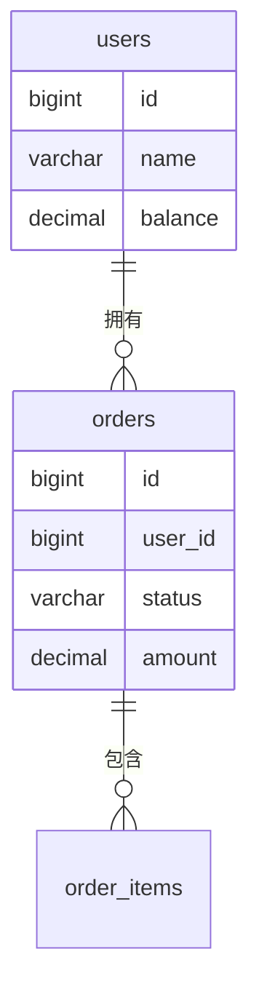

# <version> 数据表文档

> 本文档回答「**数据怎么存**」，让人（而非只有机器）看懂每张表干什么、每个字段什么含义。
> 后端项目涉及数据库变更（新增表、新增字段、调整结构）时**必含**。
> 数据库类型/版本、schema 和迁移路径从项目核实。沿用已有迁移机制，文档与实际模型及迁移交叉核对；下文类型仅为示例，按真实方言填写。
>
> 接口设计 → `dev.md`　　业务含义 → `prd.md`

---

## 表清单总览

| 表名 | 用途（一句话） | 变更类型 | 关联表 |
|------|--------------|---------|--------|
| `orders` | 存储订单主信息 | 新增 | `users` |
| `users` | 新增余额字段 | 修改 | - |

---

## 表：`[表名]`（新增）

**用途**：[一句话说明这张表存什么、为什么需要它]

**字段**：

| 字段 | 类型 | 允许空 | 默认值 | 含义 |
|------|------|--------|--------|------|
| `id` | BIGINT | 否 | 自增 | 主键 |
| `status` | VARCHAR(20) | 否 | `pending` | 订单状态，枚举值见下 |
| `amount` | DECIMAL(10,2) | 否 | 0.00 | 订单金额（元） |
| `created_at` | DATETIME | 否 | 当前时间 | 创建时间 |

**枚举值说明**：

| 字段 | 值 | 业务含义 |
|------|-----|---------|
| `status` | `pending` | 待支付 |
| `status` | `paid` | 已支付 |
| `status` | `closed` | 已关闭（超时/取消） |

> 枚举值必须写全并给出业务含义——这是后续排查数据问题时最常查的表。

**索引**：

| 索引 | 字段 | 用途 |
|------|------|------|
| `idx_user_id` | `user_id` | 按用户查订单列表 |

**关联关系**：`user_id` → `users.id`（一个用户多个订单）

---

## 表：`[表名]`（修改）

**变更说明**：[为什么改]

| 变更类型 | 字段 | 类型 | 含义 |
|---------|------|------|------|
| 新增字段 | `balance` | DECIMAL(10,2) | 账户余额（元） |
| 修改字段 | `status` | VARCHAR(10) → VARCHAR(20) | 状态值变长 |

> 存量数据如何处理（回填默认值 / 迁移脚本）写在项目实际数据迁移中，此处注明即可。

---

## 表关系图

> 涉及多张表时必含，一眼看清表间关系。

---

## 数据迁移说明

> 有存量数据需要回填/迁移时填写，否则删除本节。

- [迁移内容、影响行数预估、执行前提、对应迁移文件/段落]
