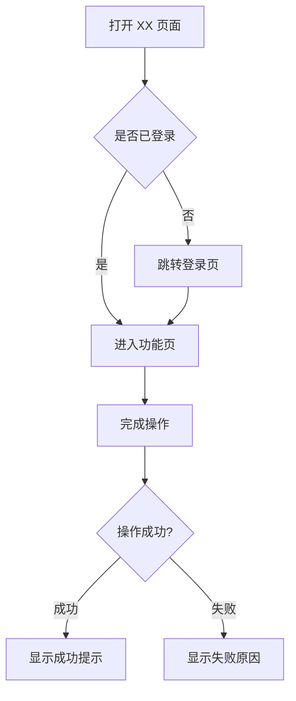
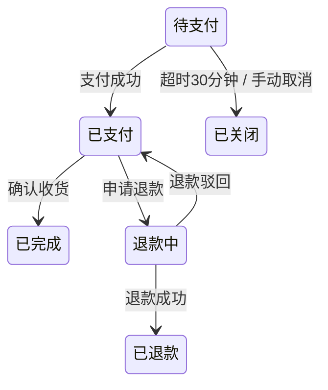

# <version> 产品需求文档

**项目名称**: [项目名称]
**创建日期**: [日期]
**负责人**: [负责人]

> 本文档有两类读者：
> - **使用人**：评审需求理解是否正确、验收时逐条对照。读「功能清单 / 各需求的原始需求、需求分析、使用链路、验收标准」即可。
> - **AI / 开发者**：实现依据。技术实现（接口、字段、框架、文件路径）不在本文档 → `dev.md`；时间排期 → `plan.md`；界面设计 → `design.md`。
>
> 验收标准应可由使用人操作并判断；目标、分析和假设可以解释背景，但不得冒充已验证事实。技术检查移到 dev.md/test.md。
>
> 需求 ID 沿用已有编号；新需求分配稳定的 S1/S2 等 ID，排序变化不重编号。

---

## 版本概述

一段话描述本版本的核心目标。

### 成功指标

- [可衡量的成功指标 1]
- [可衡量的成功指标 2]

---

## 大纲

> 每个需求一行概括，让人 30 秒看清这个版本做什么。需求较多时先读大纲再决定是否细看某段。

| 需求 | 一句话概括 | 优先级 |
|------|-----------|--------|
| [需求 1：标题] | [这段需求要解决什么、核心做法] | P0 |
| [需求 2：标题] | [这段需求要解决什么、核心做法] | P1 |

---

## 功能清单

> 本版本全部功能点的总览，从各需求分析中拆解汇总。
> 评审①时：使用人据此确认「没漏、没多」。
> 评审②（验收）时：逐项回填验收结果。

> 变更类型：新增 / 变更 / 沿用 / 移除。ID 只增不复用；移除的功能点保留一行并标「已移除」；拆分、合并写明去向（见 references/lifecycle.md）。
> 增量版本只列新增、变更、移除项；沿用项一行带过并链接上一版。

| # | 所属需求 | 功能点 | 优先级 | 变更类型 | 验收结果 |
|---|---------|--------|--------|---------|---------|
| F1 | S1 | [功能点描述] | P0 | 新增 | ⬜ 待验收 |
| F2 | S1 | [功能点描述] | P1 | 新增 | ⬜ 待验收 |
| F3 | S2 | [功能点描述] | P0 | 变更 | ⬜ 待验收 |

---

## S1：[标题]

### 1.1 原始需求

> 使用人的原始描述，**原样保留，不改写、不美化**。这是评审①时的对照基准——分析是否理解歪了，拿原始需求一对便知。

[原始需求原文]

### 1.2 需求分析

AI 对需求的理解，评审①时重点确认：

- **是什么**：[一段话说明这个需求到底是什么]
- **边界**：
  - 做：[本需求覆盖什么]
  - 不做：[明确排除什么——防止后续范围蔓延扯皮]
- **关键假设**：[AI 推断出来、需要使用人确认的点，如「假设只有管理员能操作」]

### 1.3 需求目标

- [要达成什么结果，如何衡量]

### 1.4 使用链路

使用人从进入到完成目的的完整路径。**超过 3 步、或存在分支判断时必须配流程图**；纯线性两步以内可用文字。

链路说明：
1. [步骤 1：谁，在什么入口，做什么]
2. [步骤 2]
3. [分支点：什么条件下走哪条路]

### 1.5 需求详情

**功能要求**：
1. [功能点 A：具体描述，含输入什么、看到什么]
2. [功能点 B]

**异常场景**：
- [如：网络失败时显示什么、数据为空时页面什么样]

### 1.6 状态流转

> 需求涉及**有状态的对象**（订单、任务、申请、审核单、提现单…）时本节必含：画出全部状态和触发条件，「什么情况下状态变成 X」必须一目了然。无状态对象的需求删除本节。

| 状态 | 含义 | 什么情况下进入该状态 |
|------|------|---------------------|
| 待支付 | 订单已创建未付款 | 用户提交订单 |
| 已支付 | 款项已到账 | 支付回调成功 |
| ... | | |

### 1.7 验收标准

> 全部使用**业务语言**：每条 = 操作 + 预期结果，使用人可照着做并判断对错。
> 反例：「接口返回 200」「token 写入缓存」「字段非空校验」。
> 正例：「输入手机号点『获取验证码』，60 秒内收到短信」。

- [ ] [做什么操作]，[应看到什么结果]
- [ ] [做什么操作]，[应看到什么结果]
- [ ] [异常操作]，[应看到什么提示]

---

## S2：[标题]

### 2.1 原始需求

[原始需求原文]

### 2.2 需求分析

- **是什么**：
- **边界**：做 / 不做
- **关键假设**：

### 2.3 需求目标

- [目标]

### 2.4 使用链路

[文字描述或 mermaid 流程图]

### 2.5 需求详情

**功能要求**：
1. [功能点 A]

### 2.6 状态流转

[涉及状态对象时填写，否则删除本节]

### 2.7 验收标准

- [ ] [操作]，[预期结果]

---

## 非功能需求

> 用使用人可感知的方式描述，不写纯技术指标。

### 性能要求
- [如：名单 1000 条以内，页面打开不超过 3 秒]

### 兼容性要求
- [如：支持 Chrome / 微信内置浏览器；手机端可正常操作]

### 安全要求
- [如：导出文件仅本人可下载]

---

## 约束与依赖

> 此处记录**业务约束**和**外部依赖**，不记录技术实现细节（技术约束放 dev.md）

- [业务约束，如：必须兼容现有数据格式、受监管要求限制]
- [外部依赖，如：依赖第三方服务 X 上线、需要运营配置数据]

---

## 待决问题

| ID | 问题 | 状态 | 决定 | 日期 | 影响需求 |
|----|------|------|------|------|---------|
| Q1 | [待确认的问题] | 开放 | | | S1 |

> 状态：开放 / 已决 / 搁置。已决问题保留，不删行。

---

## 修订记录

> 状态进入「已确认」（基线）后，每次改需求追加一行。

| 日期 | 变更 | 影响 ID | 原因 | 确认人 |
|------|------|---------|------|--------|
